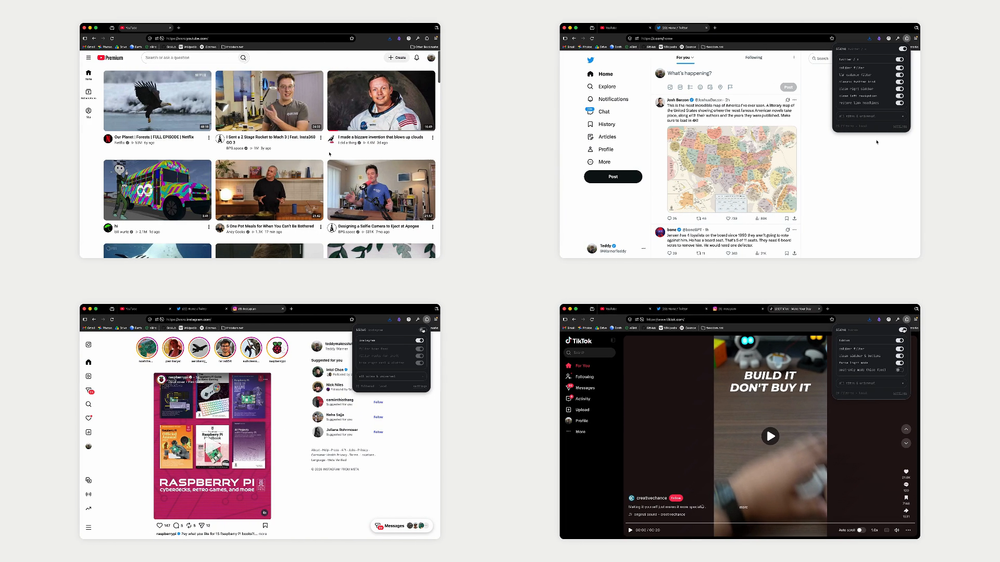

There is *sooo* much good content out there and its such a shame most rec algorithms are built to one shot you into a brain dead state. Here is an extension to help
---



## 1. Clone

```bash
git clone --recurse-submodules https://github.com/Twarner491/sieve.git ~/sieve
cd ~/sieve
```

---

## 2. Load in Firefox

Open [`about:debugging#/runtime/this-firefox`](about:debugging#/runtime/this-firefox), click **Load Temporary Add-on...**, and select `~/sieve/extension/manifest.json`.

For a persistent unsigned `.zip` on Firefox Developer Edition or Nightly (with `xpinstall.signatures.required` set to `false` in `about:config`):

```bash
npm install
npx web-ext build -s extension -a dist
```

---

## 3. Build from Source (Optional)

Prebuilt bundles are included in `extension/dist/`. If you modify `src/` or refresh upstream seed lists:

```bash
npm install
npm run seeds
npm run build
```

---

## 4. Local LLM Grader (Optional)

Seed lists, ratio filters, DeArrow title lookups, and UI debloat run immediately with no model installed. To enable live local batch grading for unseen feed items:

```bash
brew install ollama
ollama pull qwen2.5:3b
ollama serve
```

Or switch **mode** to `api` in **Settings** to use any OpenAI-compatible chat completions endpoint.

---

- [Fork this repository](https://github.com/Twarner491/sieve/fork)
- [Watch this repo](https://github.com/Twarner491/sieve/subscription)
- [Create issue](https://github.com/Twarner491/sieve/issues/new)
